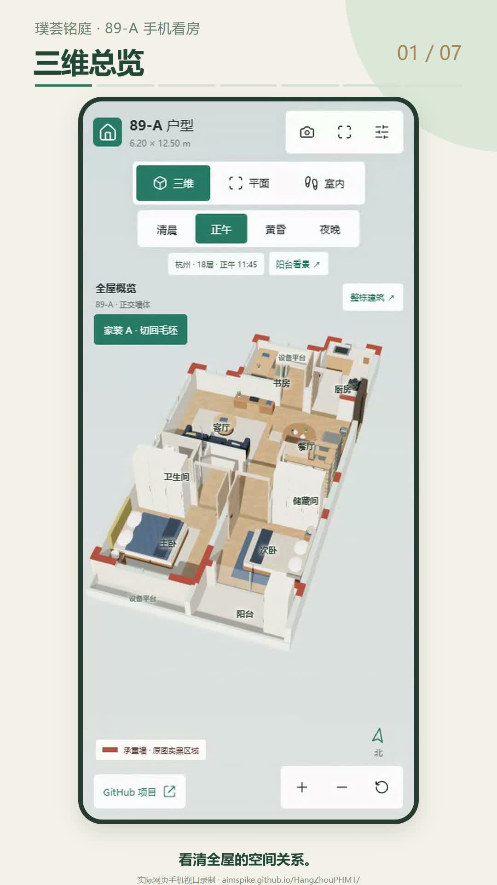
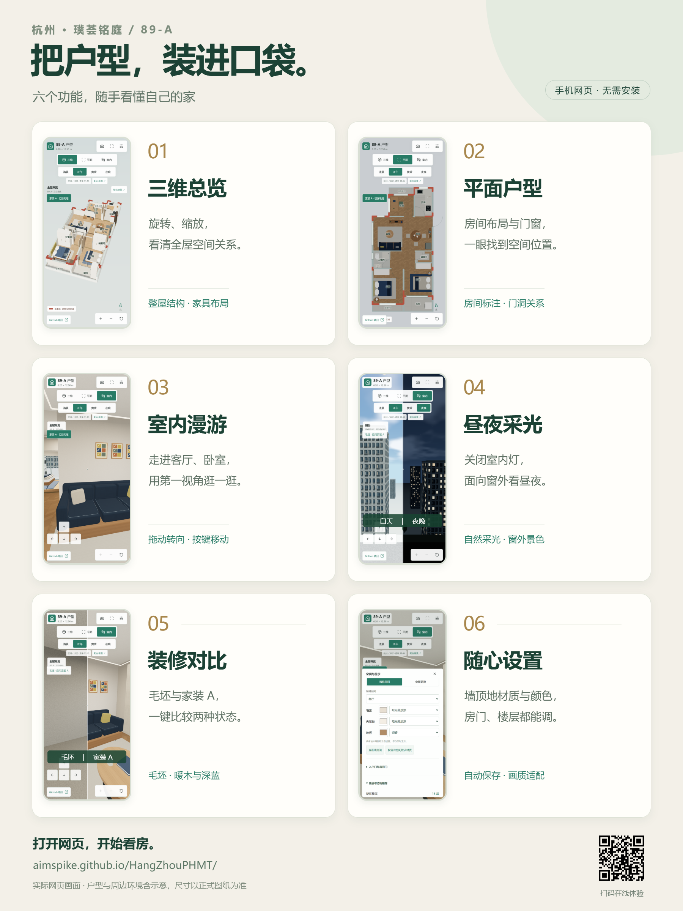

# 杭州 · 璞荟铭庭

**把户型，装进口袋。**

从一张户型照片出发，把 89-A 的空间、采光、装修和门窗放进浏览器，方便在电脑、手机和微信里查看与讨论。

## 开始看房

**[打开 3D 在线体验 →](https://aimspike.github.io/HangZhouPHMT/)**

[体验家装方案 A](https://aimspike.github.io/HangZhouPHMT/?decor=a) · [查看平面图](../plans/restored-floor-plan.svg) · [下载图纸 PDF](../plans/restored-floor-plan.pdf)

无需安装。支持三维总览、平面户型和室内漫游，也可以切换昼夜、搭配材质、开关房门。拖动转向、双指缩放；室内使用方向按钮，电脑可用 WASD 或方向键移动。

## 赞赏支持

如果这个项目对你有帮助，欢迎自愿赞赏，支持投入更多时间完善看房功能。也欢迎点个 **Star**，让更多邻居发现它。

  

使用微信扫码；点击图片可查看大图。

## 60 秒，看懂主要功能

点击封面观看新版竖屏演示，包含柔和自然的普通话女声、同步字幕和背景音乐。

  

**[观看或下载 60 秒自然女声版 →](https://aimspike.github.io/HangZhouPHMT/preview/main/promo/mobile-feature-tour-60s-soft-voice.mp4)** · [下载字幕](https://aimspike.github.io/HangZhouPHMT/preview/main/promo/mobile-feature-tour-60s-soft-voice.srt)

三维旋转、平面布局、家装漫游、无家具毛坯漫游、昼夜采光、装修切换，以及材质、房门和楼层设置。最新素材提供预览链接，正式看房入口见上方“开始看房”。画面来自实际网页手机视口录制。

## 六个功能，随手看懂自己的家

  

[打开或下载六宫格原图](https://aimspike.github.io/HangZhouPHMT/preview/main/promo/app-features-six-grid-v3.png)

| 功能 | 可以体验什么 |
| --- | --- |
| 三维总览 | 旋转、缩放，查看全屋结构与家具布局 |
| 平面户型 | 查看房间、门窗、门洞关系及原图实黑墙段标记 |
| 室内漫游 | 走进房间，转身与前进，观察家具和通道 |
| 昼夜采光 | 切换清晨、正午、黄昏与夜晚，分别调整日照、天光和室内灯 |
| 装修对比 | 切换无家具的毛坯与暖木、米白、深蓝的家装方案 A |
| 随心设置 | 调整墙顶地材质、颜色、房门、楼层与画质，自动保存个人设置 |

## 关于这个项目

HangZhouPHMT 是璞荟铭庭 89-A 户型的平面图复原与 3D 交互浏览项目。家装 A 参考了 9 张效果图，适配现有户型；可以继续调整各房间材质，并通过通用相机功能导出当前画面。

[查看实际场景截图](../assets/interior/preset-a/README.md) · [查看装修参考图](../references/interior/preset-a/README.md) · [小区概况与资料来源](../references/phmt/README.md)

照片复原尺寸、墙高和家具含估算，图纸不能用于施工；承重标记根据原图实黑区域转录，结构性质以正式结构图为准。楼栋与周边环境包含示意内容。已进行桌面和手机视口、微信 UA 模拟检查，实际手机微信仍需实机核验。

遇到墙顶阴影条纹，可在实际手机中打开[本机显示检测](https://aimspike.github.io/HangZhouPHMT/?release=14.2&verify=mobile)，按[检测说明](../context/MOBILE_VERIFICATION.md)查看画面并导出报告。

## 项目资料

[项目说明与制作规范](../README.md) · [后续 TodoList](../context/TODO.md) · [宣传素材说明](../assets/promo/mobile-v14.2/README.md) · [开发测试版](https://aimspike.github.io/HangZhouPHMT/preview/main/)
