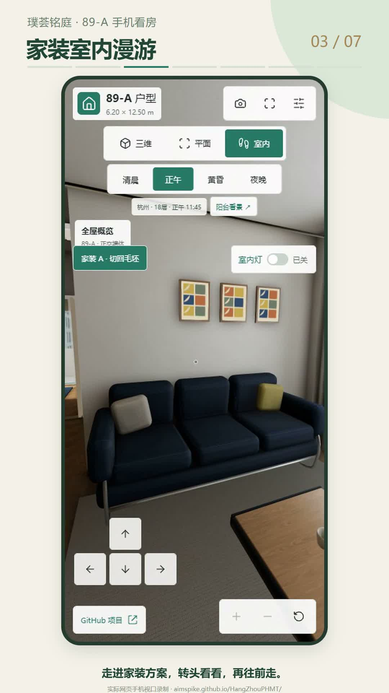
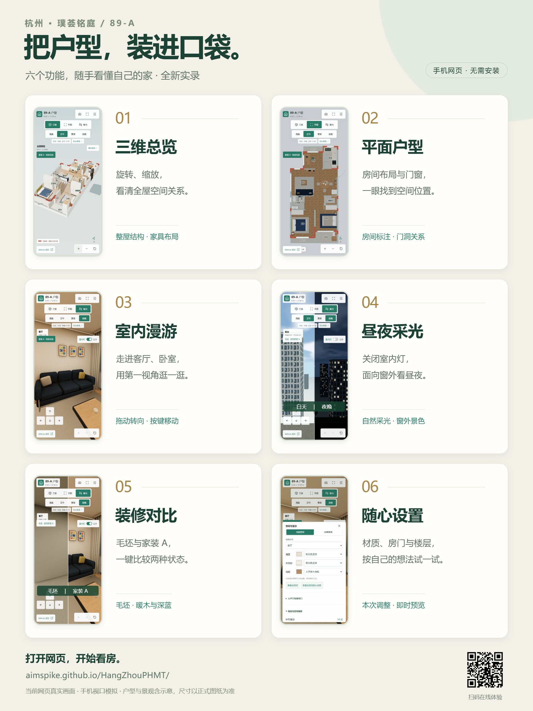

# 杭州 · 璞荟铭庭

**先在手机里，逛一遍自己的家。**

从客厅到卧室怎么走，站在阳台能看到什么，毛坯装上家具是什么样子——打开 89-A 户型，转一转、走一走，再慢慢试出自己喜欢的搭配。

**[打开 89-A，开始看房 →](https://aimspike.github.io/HangZhouPHMT/)**

不用安装，手机、电脑都能打开。想直接看摆好家具的样子，可以[从家装 A 开始逛](https://aimspike.github.io/HangZhouPHMT/?decor=a)。

## 看得顺手，欢迎一起支持

如果它帮你看懂了户型、想清了装修，欢迎自愿赞赏，支持继续完善。也可以点右上角 **Star** 收藏，或把[看房链接](https://aimspike.github.io/HangZhouPHMT/)发给家人和邻居，一起边看边聊。

  

使用微信扫码；点击图片可查看大图。

## 先看一遍，再跟着试

点下面的封面，用一分钟跟着转户型、走进房间、切换昼夜和装修。看完后[打开看房页面](https://aimspike.github.io/HangZhouPHMT/)，按自己的节奏试一遍。

  

**[播放或下载一分钟演示 →](https://aimspike.github.io/HangZhouPHMT/promo/mobile-feature-tour-60s-v6.mp4)** · [下载字幕](https://aimspike.github.io/HangZhouPHMT/promo/mobile-feature-tour-60s-v6.srt)

## 这张图，留着边看边试

  

[打开或保存这张操作图](https://aimspike.github.io/HangZhouPHMT/promo/app-features-six-grid-v4.png)

## 找到喜欢的样子，存下来一起聊

逛到喜欢的角度，点右上角相机保存画面，发给家人讨论。手机里出现图片预览后，可以长按保存。

[先翻翻房间截图](../assets/interior/preset-a/README.md) · [看看装修灵感](../references/interior/preset-a/README.md) · [了解小区与资料来源](../references/phmt/README.md)

想体验最近的调整，可以[打开新版预览](https://aimspike.github.io/HangZhouPHMT/preview/main/?decor=a)。预览与正式入口的既有设置相互隔离。正式版与预览目前均暂停保存与账号同步，新调整仅本次浏览生效。

## 遇到显示问题，再来这里

如果墙面或天花板出现奇怪条纹，在出现问题的手机浏览器或微信里打开[本机显示检测](https://aimspike.github.io/HangZhouPHMT/?verify=mobile)，按[这份说明](../context/MOBILE_VERIFICATION.md)查看画面并导出报告。

看房画面和家具用于帮助理解空间与讨论搭配，尺寸、承重墙与实际景观请以正式图纸和现场为准。

**[现在打开，按自己的想法逛一逛 →](https://aimspike.github.io/HangZhouPHMT/)**

[后续计划与进展](../context/TODO.md) · [项目维护说明](../README.md) · [演示素材](../assets/promo/mobile-v16.2-20261126/README.md)
