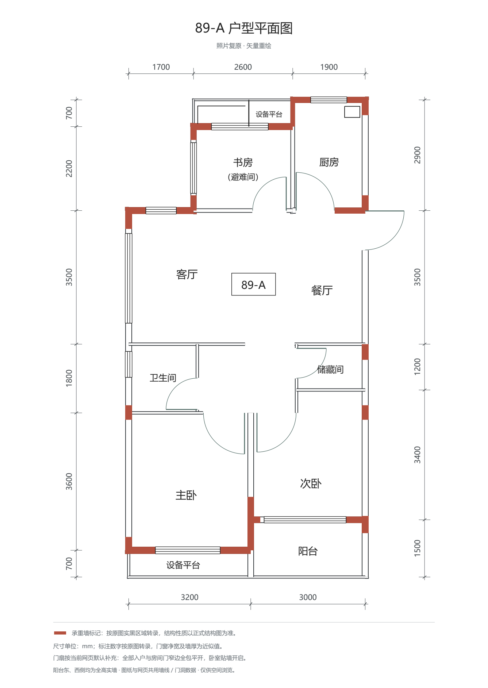

# 杭州 · 璞荟铭庭

## 3D 在线体验

**[点击打开 3D 在线体验 →](https://aimspike.github.io/HangZhouPHMT/)**

电脑、手机、微信均可浏览，支持三维、平面、室内漫游与采光、材质调整。

[查看矢量平面图](plans/restored-floor-plan.svg) · [下载 PDF](plans/restored-floor-plan.pdf) · [小区资料与来源](references/phmt/README.md)

## 赞赏支持

如果这个项目对你有帮助，欢迎自愿赞赏，支持后续整理与维护。

  

使用微信扫码；点击图片可查看大图。

在线展示页在前台浏览满一分钟后，也会显示一次可关闭的赞赏提示，附带 GitHub Star 入口。

## 项目介绍

**HangZhouPHMT** — 璞荟铭庭 89-A 户型的平面图复原与 3D 交互浏览项目。

从一张户型照片出发，把空间、采光、材质和门的开合放进浏览器，方便在电脑、手机和微信里查看与讨论。

## 关于璞荟铭庭

璞荟铭庭位于**杭州市滨江区**，是人才共有产权保障住房项目，由**杭州滨江城建发展有限公司**开发建设。2024 年公开配售房源涉及 1—4 号楼，共 **368 套**，户型面积为 **65、89㎡**，采用毛坯交付。[2] [3]

| 项目 | 公开资料摘要 |
| --- | --- |
| 位置 | 诚业南路西侧、创智街北侧；地名公告记载北至仁荣街。[1] [4] |
| 房源 | 1—4 号楼，2024 年公开配售共 368 套。[2] [3] |
| 户型与交付 | 65、89㎡，毛坯交付。[3] [4] |
| 楼栋规模 | 房产平台记载为 4 幢高层，21—25 层。[5] |
| 规划指标 | 房产平台记载容积率 2.5、绿化率 35%。[5] |
| 建设单位 | 杭州滨江城建发展有限公司。[2] [4] |

以上为公开资料整理，查阅于 **2026-11-19**。不同来源的面积、道路和个别字段存在差异，详见[资料核对说明](references/phmt/README.md#资料差异与采用原则)。本仓库为个人户型可视化项目，楼栋和周边环境包含示意内容。

## 可以体验什么

- **三维 / 平面 / 室内漫游**：查看空间关系、门洞和原图实黑墙段标记。
- **日照与灯光**：清晨、正午、黄昏、夜晚四种环境，包含太阳、天光和室内灯的烘焙光照。
- **材质搭配**：按房间或全屋更换墙壁、天花板、地板的颜色与材质。
- **门与楼层**：查看平开门、吊轨推拉门的开合，调整所在楼层和透明楼栋。
- **设置保存**：浏览器自动保存，支持 JSON 导入、导出；账号云同步已准备接入步骤，需自行配置服务后启用。

### 打开与操作

手机、微信可直接打开[在线链接](https://aimspike.github.io/HangZhouPHMT/)。也可以下载 [docs/index.html](docs/index.html)，在支持 WebGL 的浏览器中离线打开；模型、贴图和脚本全部内嵌在一个 HTML 中。

拖动转向，双指缩放；室内使用方向按钮，电脑可用 WASD / 方向键移动。右上角设置可调整 FOV、眼高、灯光、材质、门和楼层。

模型按用户提供的**阳台南偏西 10°**设置朝向，日照采用杭州的近似太阳位置。默认所在楼层 18 层、层高 3m；透明楼栋的总层数可调整，默认值仅作演示。

照片复原的尺寸、墙高和未标注几何含估算，图纸不能用于施工；承重标记转录自原图实黑区域，结构性质以正式结构图为准。已做桌面和手机 / 微信 UA 模拟验证，手机微信真机表现仍需实机核验。

## 资料与维护

| 目录 / 文档 | 内容 |
| --- | --- |
| [小区资料](references/phmt/README.md) | 项目概况、历史节点、来源与差异核对 |
| [plans/](plans/) | 复原平面图 SVG、PDF、PNG |
| [references/](references/) | 用户提供的户型 / 整层参考图与小区资料 |
| [开发说明](context/DEVELOPMENT.md) | 构建、光照重烘焙、版本说明与验证范围 |
| [发布记录](context/DEPLOYMENT.md) | GitHub Pages 部署与维护 |
| [云同步部署](cloud/README.md) | 可选 Supabase 账号同步配置步骤 |
| [续接上下文](context/HANDOFF.md) | 需求和实现摘要，便于继续维护 |

Pages 从 `main` 分支的 `/docs` 发布。源码在 `src/`，使用 `python src/build_house.py` 生成最终 HTML。第三方库授权见 [licenses/THIRD_PARTY.md](licenses/THIRD_PARTY.md)。

### 介绍资料来源

1. [杭州市民政局：地名公告（杭地公告〔2024〕21号）](https://mz.hangzhou.gov.cn/art/2024/8/2/art_1229321287_4288303.html)，2024-08-02。名称和位置采用该条目；政区字段的冲突见资料核对说明。
2. [杭州市国立公证处：璞荟铭庭人才共有产权房公开销售公证摇号公告](https://www.hz-notary.com/lottery/detail_content?lotteryContent.id=5273cf95c5d84933990d8bc3f41161a4)，2024-09-20。
3. [住在杭州网：璞荟铭庭（人才共有产权房）摇号详情](https://xinpan.zjol.com.cn/m/lottery/4180.html)，2024 年配售信息。
4. [住在杭州网：璞荟铭庭楼盘详情](https://xinpan.zjol.com.cn/m/more-detail/4179.html)。
5. [房天下：璞荟铭庭基本信息](https://hz.newhouse.fang.com/loupan/2010201150/housedetail.htm)。

[1]: https://mz.hangzhou.gov.cn/art/2024/8/2/art_1229321287_4288303.html
[2]: https://www.hz-notary.com/lottery/detail_content?lotteryContent.id=5273cf95c5d84933990d8bc3f41161a4
[3]: https://xinpan.zjol.com.cn/m/lottery/4180.html
[4]: https://xinpan.zjol.com.cn/m/more-detail/4179.html
[5]: https://hz.newhouse.fang.com/loupan/2010201150/housedetail.htm
