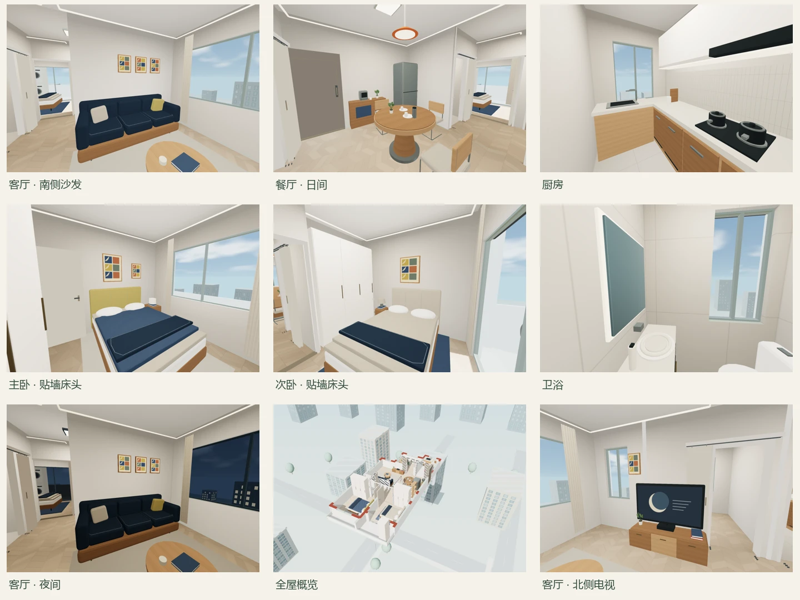
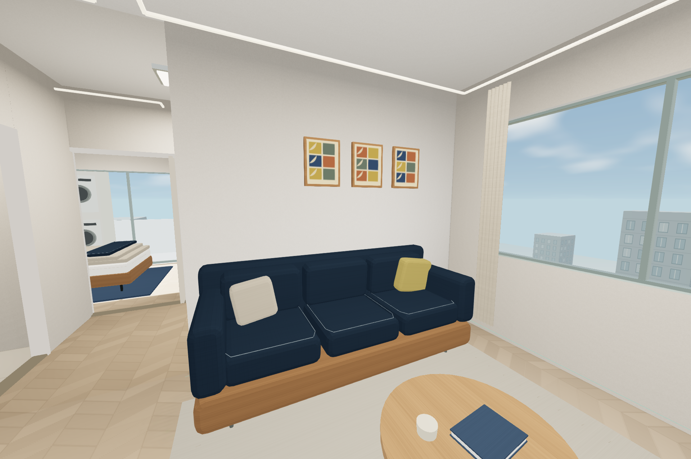
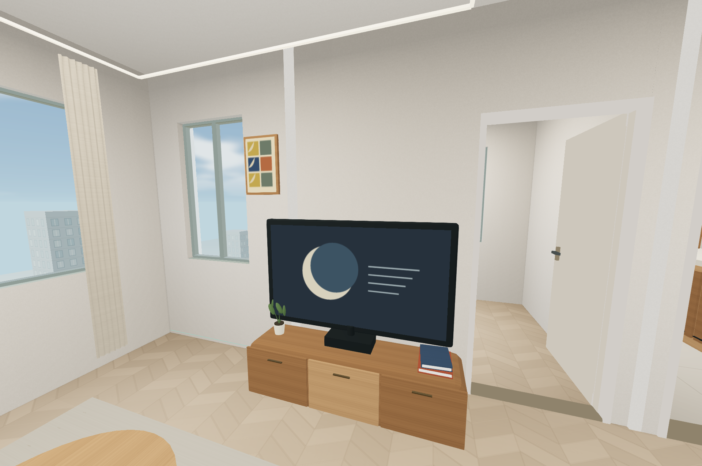
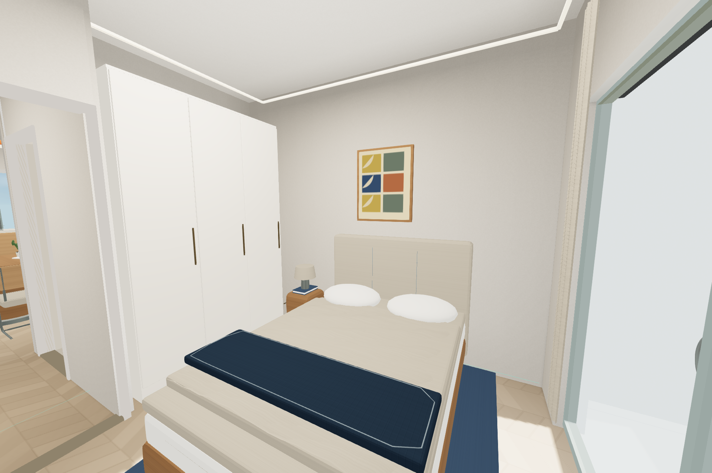
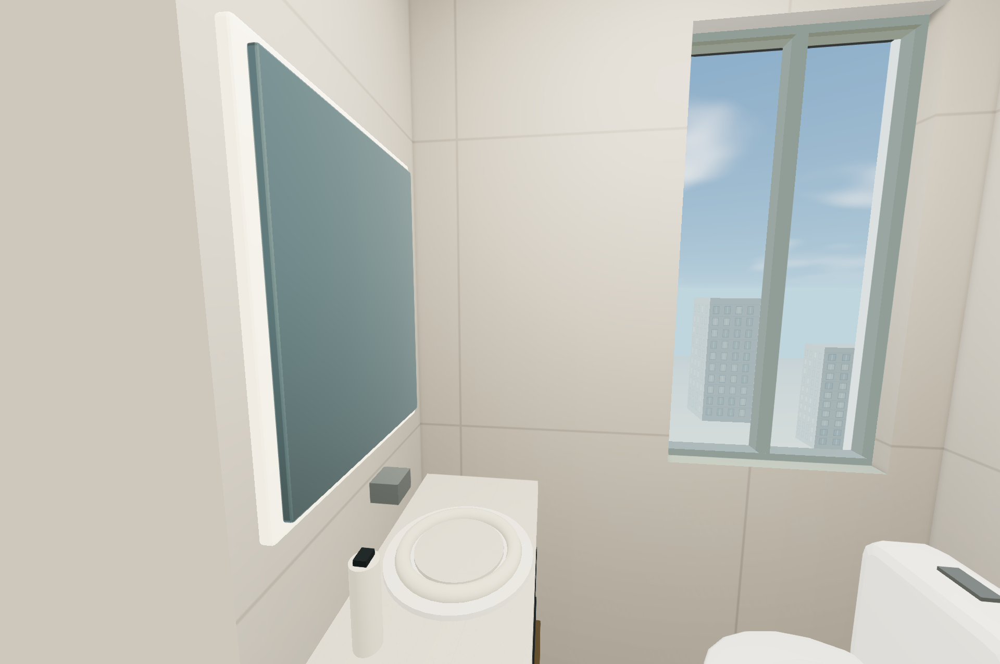
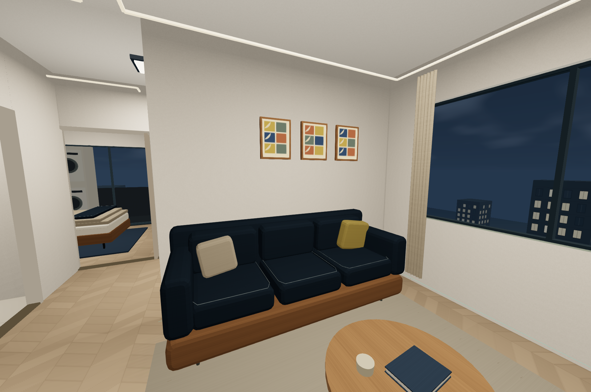

# 家装预设 A · 网页实景截图

[打开可切换的 3D 家装方案](https://aimspike.github.io/HangZhouPHMT/?decor=a) · [查看 9 张用户参考图与分类](../../../references/interior/preset-a/README.md)

这些图片直接导出自本项目 WebGL 画布，展示当前可浏览的 3D 家装方案。不是原参考效果图，也不是 AI 生成或离线写实渲染。相机、光照时段等记录在 [captures.json](captures.json)。

方案取参考图的暖木、米白、深蓝、芥末色和少量橙色，按原 89-A 户型适配家具，保留原墙线、门洞、楼层与朝向。原图和网页的空间关系不完全一致：两间卧室暂按是否邻阳台对应，干区台盆放在原卫生间内，没有按效果图改墙。

客厅按参考图修正为北侧电视、南侧沙发；电视柜前移，保留书房外挂推拉门的停放空间。主卧床头朝西贴墙，次卧床头贴东墙，衣柜背面贴北侧墙，床另外三边留出通行空间。阳台东西两侧均按用户确认改为全高实墙，其中西侧与邻居相连；图纸与建筑光照已同步更新。

## 日间空间

| 客厅 | 餐厅 |
| --- | --- |
|  |  |

| 厨房 | 主卧 |
| --- | --- |
|  |  |

| 次卧 | 卫浴 |
| --- | --- |
|  |  |

## 夜间与全屋

## 浏览和保存

- 点击页面装修快捷按钮，或在设置 → 装修方案中切换；“毛坯方案”无家具，默认墙顶地为水泥基底。
- 方案 A 和毛坯方案的材质分别保留，可继续分房间调整；刷新与设置 JSON 导入导出会保留当前方案。旧“原有方案”设置自动迁移为毛坯。
- 装修方案面板仅保留方案切换与说明；参考图在仓库资料页中查看。房间选择与 FOV、眼高调节位于原有设置中。
- 右上角相机按钮导出当前画布；手机 / 微信显示可长按保存的预览图。
- 家具可隐藏；可见家具参与室内移动碰撞。七扇门的开合检查覆盖家具位置与可选门型。

家具增加织物包边、软枕与褶皱床品、柜门缝和把手、金属椅架、厨卫五金与洗烘面板。材质使用低饱和木纹、织物/石材微凹凸和程序化反射环境；镜面不反射真实房间。建筑使用离线烘焙光照，家具使用房间局部填光和地面接触阴影；家具未纳入完整 GI 烘焙。保持 WebGL1 与自包含单 HTML。
