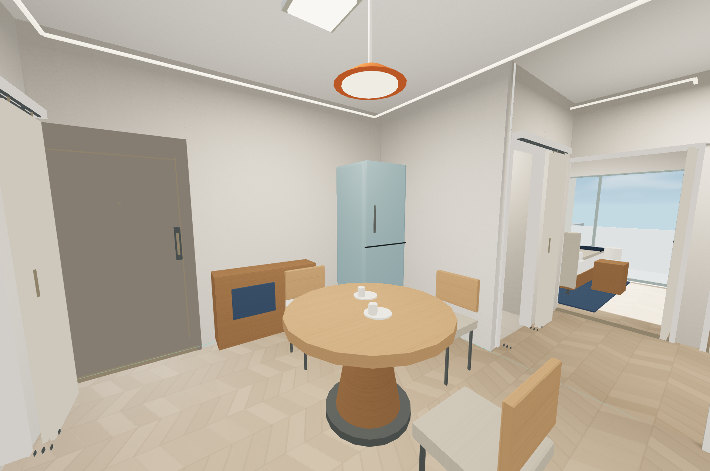
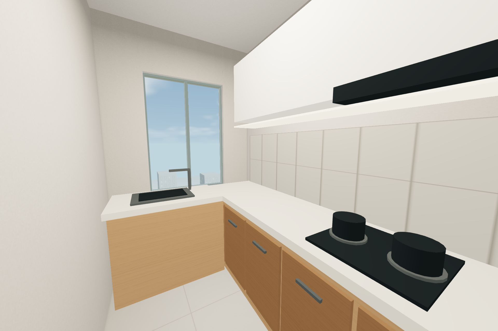
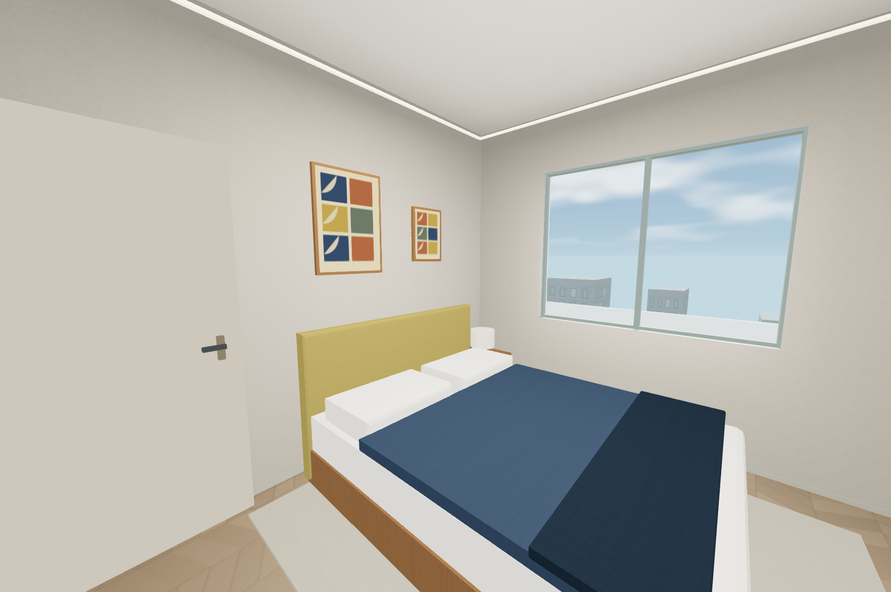
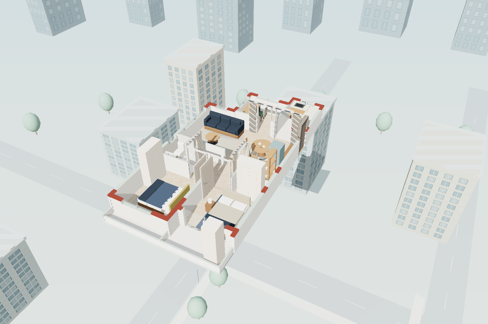

# 家装预设 A · 网页实景截图

[打开可切换的 3D 家装方案](https://aimspike.github.io/HangZhouPHMT/?decor=a) · [查看 9 张用户参考图与分类](../../../references/interior/preset-a/README.md)

这些图片直接导出自本项目 WebGL 画布，展示当前可浏览的 3D 家装方案。不是原参考效果图，也不是 AI 生成或离线写实渲染。相机、光照时段等记录在 [captures.json](captures.json)。

方案取参考图的暖木、米白、深蓝、芥末色和少量橙色，按原 89-A 户型适配家具，保留原墙线、门洞、楼层与朝向。原图和网页的空间关系不完全一致：两间卧室暂按是否邻阳台对应，干区台盆放在原卫生间内，没有按效果图改墙。

## 日间空间

| 客厅 | 餐厅 |
| --- | --- |
|  |  |

| 厨房 | 主卧 |
| --- | --- |
|  |  |

| 次卧 | 卫浴 |
| --- | --- |
|  |  |

## 夜间与全屋

## 浏览和保存

- 点击页面“家装预设 A”快捷按钮，或在设置 → 装修方案中切换；切回“原有方案”可恢复切换前的材质。
- 方案 A 和原有方案的材质分别保留，可继续分房间调整；刷新与设置 JSON 导入导出会保留当前方案。
- 设置 → 室内观景位置可直接进入各房间的预设视角，使用 FOV 与眼高滑块继续调整。
- 相机按钮或“保存当前效果图”导出当前画布。手机 / 微信显示可长按保存的预览图。
- 家具可隐藏；可见家具参与室内移动碰撞。七扇门的开合检查覆盖家具位置与可选门型。

当前使用既有建筑烘焙光照、新增家具的房间局部填光和地面接触阴影。家具未进入原有建筑光照烘焙，不提供完整实时全局光照或镜面反射；发光镜面为视觉示意。保持 WebGL1 与自包含单 HTML。
