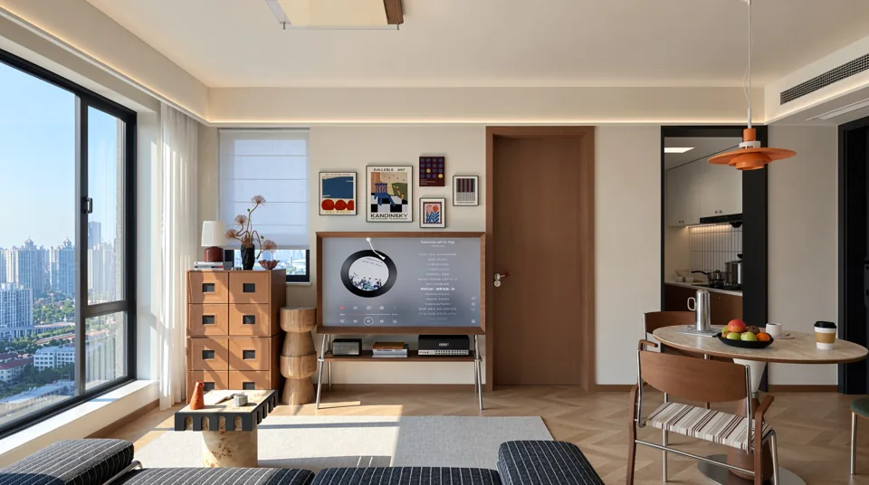
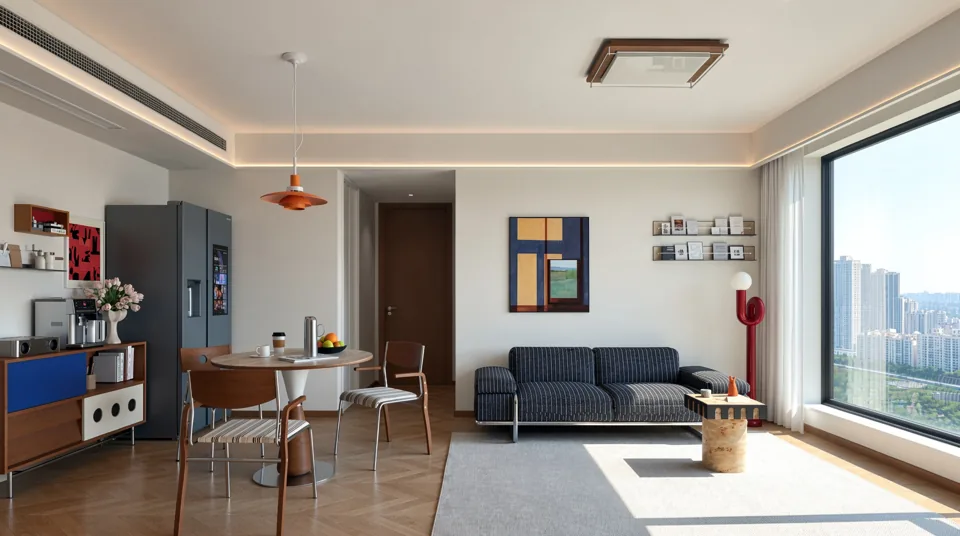
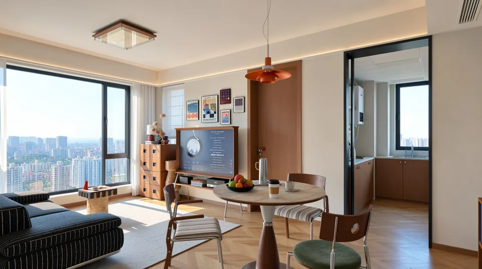
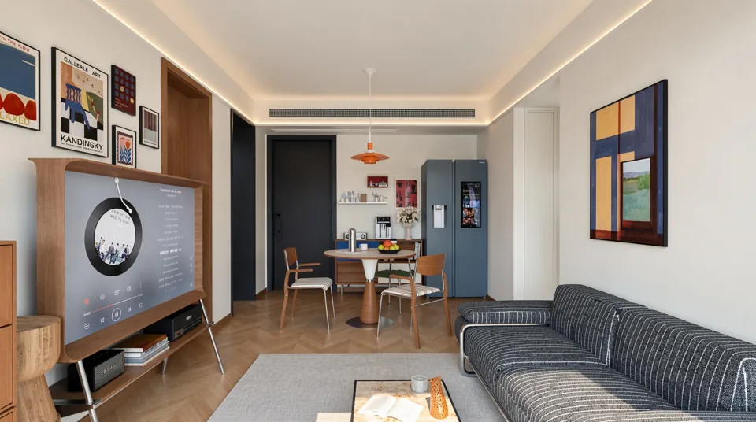
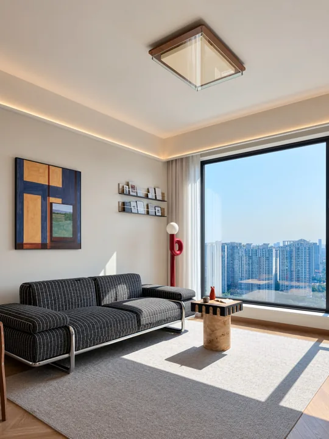
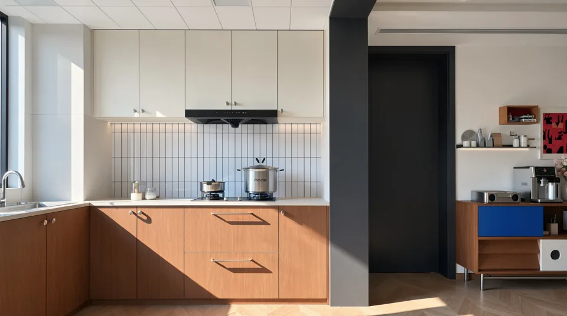
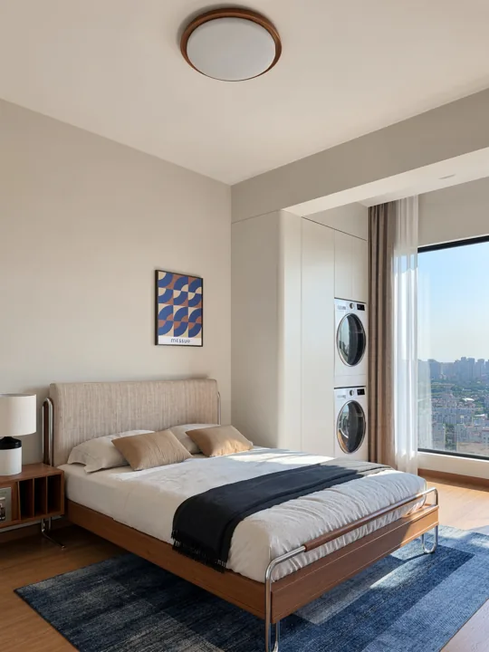
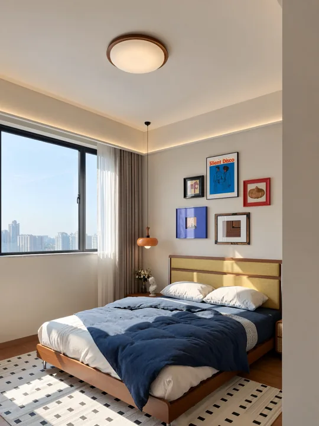
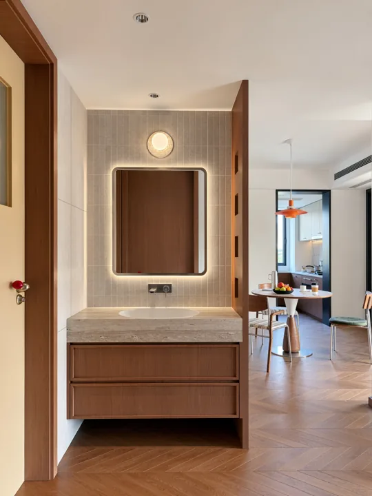

# 家装预设 A · 参考图片

这9张图片由用户提供，原始JPG按空间/视角分类命名后原样入库；WebP仅为浏览预览。原文件名、尺寸和SHA256见[manifest.json](manifest.json)。

[切换到 3D 家装预设 A](https://aimspike.github.io/HangZhouPHMT/?decor=a) · [查看实际 3D 场景截图](../../../assets/interior/preset-a/README.md)

## 风格与位置判断

客餐厅五张、厨房一张、卧室两张、卫浴/过道干区一张。整体为暖白墙顶、木色家具与地板、深蓝布艺，橙色/芥末色作小面积点缀。卧室按“邻阳台”和“窗边画墙”区分，暂映射次卧/主卧；干区图片与原户型边界关系未确认。不能据这些效果图更改原户型墙线、窗或门洞。

## 客餐厅 · 电视墙与餐桌

电视矮柜、斗柜、橙色吊灯和木地板；相邻木门为参考图中的门位，不据此修改原户型门洞。

- 文件：[living-dining/01-tv-wall-and-dining.jpg](living-dining/01-tv-wall-and-dining.jpg)
- 定位把握：较高。

## 客餐厅 · 沙发、餐桌与餐边柜

深蓝条纹沙发、圆餐桌、灰色冰箱和低餐边柜。

- 文件：[living-dining/02-sofa-dining-and-sideboard.jpg](living-dining/02-sofa-dining-and-sideboard.jpg)
- 定位把握：较高。

## 客餐厅 · 从餐桌看客厅与厨房

前景餐桌、左侧沙发、右侧厨房入口，用于核对客餐厨风格关系。

- 文件：[living-dining/03-dining-toward-living-and-kitchen.jpg](living-dining/03-dining-toward-living-and-kitchen.jpg)
- 定位把握：较高。

## 客餐厅 · 从客厅看入口与餐区

近景沙发和电视墙、远景入户及餐桌，四张横图属于同一客餐厅的不同视角。

- 文件：[living-dining/04-living-toward-entry-and-dining.jpg](living-dining/04-living-toward-entry-and-dining.jpg)
- 定位把握：较高。

## 客厅 · 沙发与窗边细节

深蓝沙发、米灰地毯、金属木质茶几与几何挂画。

- 文件：[living-dining/05-sofa-window-detail.jpg](living-dining/05-sofa-window-detail.jpg)
- 定位把握：较高。

## 厨房 · L形橱柜与餐边区域

木色地柜、奶油白吊柜、浅色台面与竖向小砖；入口关系仅作参考。

- 文件：[kitchen/01-l-shaped-wood-cabinet-kitchen.jpg](kitchen/01-l-shaped-wood-cabinet-kitchen.jpg)
- 定位把握：较高。

## 卧室 · 邻阳台与洗烘区（暂对应次卧）

带软包床头、白床品和深蓝床尾毯，右侧可见洗烘柜及大玻璃开口；依据原户型仅次卧邻阳台暂归次卧，未核实是否为同户型。

- 文件：[bedrooms/01-bedroom-balcony-laundry.jpg](bedrooms/01-bedroom-balcony-laundry.jpg)
- 定位把握：暂定，待用户核实。

## 卧室 · 窗边床与画墙（暂对应主卧）

芥末色床头、深蓝床品和蓝橙画墙；与另一卧室区分，暂归主卧，朝向与准确门窗关系不能仅凭图片确认。

- 文件：[bedrooms/02-bedroom-window-gallery-wall.jpg](bedrooms/02-bedroom-window-gallery-wall.jpg)
- 定位把握：暂定，待用户核实。

## 卫浴 / 过道 · 干区台盆与餐厅视角

悬浮木色台盆柜、浅石台面、发光圆角镜、竖砖背景；参考干区与餐厅相邻，原89-A平面不能直接确认此位置，落地方案保留卫生间原边界。

- 文件：[bath-hall/01-dry-vanity-and-dining-view.jpg](bath-hall/01-dry-vanity-and-dining-view.jpg)
- 定位把握：暂定，待用户核实。
